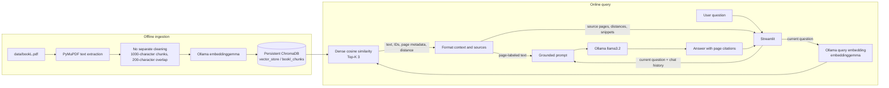

# LargeDocRAG

LargeDocRAG is a local PDF question-answering application. It extracts text from a book PDF, stores page-aware text chunks in persistent ChromaDB, retrieves relevant chunks with dense vector similarity, and asks a local Ollama chat model to answer from the retrieved context.

## Technology

- Python
- Streamlit for the chat interface
- PyMuPDF for PDF text extraction
- ChromaDB `PersistentClient` with cosine-distance dense retrieval
- Ollama with `embeddinggemma` for embeddings and `llama3.2` for answers

The baseline uses collection `bookl_chunks`, the existing `vector_store/` directory, and Top-K 3. The original notebook and 20-question CSV are retained in their existing locations.

## Project structure

```text
LargeDocRAG/
├── streamlit_app.py                 # Existing Streamlit entry point
├── requirements.txt
├── README.md
├── src/largedocrag/
│   ├── config.py                    # Shared paths and baseline settings
│   ├── ingestion.py                 # PDF extraction, chunking, and explicit ingestion helpers
│   ├── retrieval.py                 # Dense query and context/source formatting
│   ├── generation.py                # Grounded Ollama prompt and response call
│   └── evaluation.py                # Page metrics and human response-review helpers
├── evals/evaluation_dataset.json    # Preserved questions with page-level labels
├── experiments/results.csv          # Summary header; populated only by a real run
├── tests/                            # Unit tests with mocked external services
├── Evaluation/                       # Original evaluation CSV (unchanged)
├── data/bookL.pdf                    # Source PDF
├── rag_exploration.ipynb              # Original exploration notebook (unchanged)
└── vector_store/                      # Existing persistent ChromaDB data
```

## Architecture



## Ingestion flow

`ingestion.py` follows the notebook's current behavior: PyMuPDF extracts each page, then each page is split independently into 1,000-character chunks with 200 characters of overlap. Text is not additionally cleaned. Each chunk keeps its one-based page number and the stable `chunk-{index}` ID convention.

Ingestion functions receive an existing collection explicitly. They do not create, delete, or recreate collections. The notebook's count guard is preserved: equal record counts skip ingestion, an empty collection can be populated, and a partial or mismatched count raises an error. The application and evaluation runner do not invoke ingestion automatically.

## Retrieval and answer flow

`retrieval.py` embeds a question with `embeddinggemma`, calls ChromaDB's dense `query` with Top-K 3, and returns stored chunk IDs, text, metadata, and cosine distances. It formats the context with the same `[PDF page N]` labels used by the original app.

`generation.py` constructs the original system instruction, adds prior chat turns, and sends the question and retrieved context to `llama3.2`. The model is instructed to use only the supplied PDF context, say when it is insufficient, and cite relevant PDF pages. `streamlit_app.py` remains the entry point and handles the interface, session state, sidebar, and source display.

## Configuration

Default settings live in `src/largedocrag/config.py`. They point to this project directory, `data/bookL.pdf`, `vector_store/`, and the existing `bookl_chunks` collection. Model names, Top-K, chunk size, and overlap match the current project. The local Ollama installation should have both models available:

```powershell
ollama pull embeddinggemma
ollama pull llama3.2
```

No API keys or secrets are required by this local setup, so there is no `.env` file. Install Python dependencies in an environment you manage; the existing project environment is not modified by this repository setup:

```powershell
python -m pip install -r requirements.txt
```

## Run the application

From the `LargeDocRAG` directory, with the Ollama service running:

```powershell
streamlit run streamlit_app.py
```

The app opens the existing collection with `get_collection`. It does not create or ingest ChromaDB records.

## Evaluation

The original `Evaluation/MMDS_RAG_evaluation_dataset_20.csv` is unchanged. `evals/evaluation_dataset.json` carries over its 20 questions, expected answers, question types, and source PDF page labels. The JSON records leave `relevant_chunk_ids` empty because the source CSV has no chunk-level judgments.

Run the dense retrieval baseline from the project directory:

```powershell
python -m src.largedocrag.evaluation
```

The runner embeds each question, queries the existing collection, and saves per-question JSON and Excel-friendly CSV files under `experiments/retrieval_runs/`, plus an aggregate row in `experiments/results.csv`. It only queries the collection; it does not ingest, update, or delete vectors. The summary CSV contains one row per experiment; the timestamped run CSV contains one row per question.

### How page-level metrics are calculated

The existing labels identify a relevant source page, not a relevant chunk. For the initial baseline, a retrieved chunk is represented by its `page_number`; repeated retrieved chunks from the same page collapse to that page's first rank. Precision@K divides by requested K, recall divides by the number of labeled pages, MRR uses the first matching page rank, and Hit Rate@K records whether any labeled page appears. This is a useful source-page proxy, but it can credit a chunk from a labeled page even when that particular chunk does not contain the answer. It also collapses multiple chunks from one page. The scores must therefore be described as page-level baseline metrics, not chunk-level relevance measurements.

The existing 20 questions provide answerable examples with page labels. No new ambiguous, unanswerable, multi-passage, or adversarial questions have been invented. Add and label those examples before evaluating those categories.

### Human response review

`evaluation.py` provides a blank review-record structure with fields for correctness, relevance, faithfulness, groundedness, completeness, and citation quality. Values begin as `null` so a reviewer can score generated answers manually. There is no LLM-as-a-Judge implementation.

## Tests

Run the unit tests from the project directory:

```powershell
python -m unittest discover -s tests -v
```

Ollama and ChromaDB operations in the tests are mocked. The tests cover the existing settings, chunk/page metadata, prompt and context formatting, empty retrieval, metric calculations, and ingestion guards. They do not query or modify the real persistent vector store.

## Limitations

- Retrieval is dense vector similarity only; no BM25, hybrid search, or reranking is used.
- Evaluation relevance is labeled at PDF-page level because chunk-level judgments are not present.
- PDF extraction uses PyMuPDF's page text output; no OCR pipeline or separate cleaning step is present.
- The answer model can still produce unsupported text despite the grounding prompt, so response quality and citations need human review.
- The original notebook remains an exploration artifact; the Streamlit app is the application entry point.
